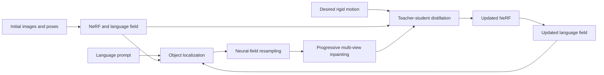

<div align="center">
<h1>NEO: NeRF It Once, Edit It Many Times</h1>
<h2> Accepted in IEEE Robotics and Automation Letters 2026 </h2>

[**Mikołaj Zieliński**](https://scholar.google.com/citations?user=ISOdWukAAAAJ&hl=en&oi=ao)<sup>1,2</sup>,
[**David Hall**](https://scholar.google.com.au/citations?user=dosODoQAAAAJ&hl=en)<sup>2</sup>,
[**Dominik Belter**](https://scholar.google.com.au/citations?user=3XvUbbMAAAAJ&hl=en&oi=ao)<sup>1</sup>,
[**Peyman Moghadam**](https://scholar.google.com.au/citations?user=QAVcuWUAAAAJ&hl=en&oi=ao)<sup>2</sup>

<sup>1</sup>Poznan University of Technology&emsp;&emsp;&emsp;<sup>2</sup>CSIRO Robotics
<br>

<a href="https://arxiv.org/abs/2607.24538v1"></a>
<a href='https://csiro-robotics.github.io/NEO/'></a>
<a href=''></a>


</div>

This is the official repository for NEO, a language-guided, persistent NeRF editing process for continuous object manipulation.

NEO predicts future scene states from a single initial scan. A text prompt
selects an object, NEO removes it from the neural field, reconstructs the
revealed background, and distills the object at its target pose into an updated
NeRF. The updated NeRF and language field can be reused for the next robot
action without scanning the scene again.

## Method



Given a set of initial images and poses, a NeRF and corresponging language field is first learnt as the starting implicit representation. 
From this representation, a 3D bounding box around an object/region for editing is defined either through a language prompt (as used in the paper) or manually through a GUI interface (see GUI section below).

After this, the editing pipeline has three stages:

1. **Object removal:** ray intervals inside the selected 3D bounding box are
   excluded and samples are reallocated to the visible parts of each ray.
2. **Background completion:** virtual object-centred views are inpainted in
   2x2 grids and used as masked supervision for NeRF refinement.
3. **Persistent reconfiguration:** original, object-removed, and transformed
   object fields supervise one student NeRF through field, RGB, and depth
   distillation.

NEO supports rigid object removal and relocation in static scenes. It does not
currently model articulated, deformable, or changing-background interactions.
Diffusion inpainting is stochastic, so repeated runs may produce different
content in regions that were never observed.

## Requirements

- Linux and Python 3.10
- NVIDIA GPU with CUDA support
- about 24 GB of GPU memory for the published NEO configuration
- FFmpeg and COLMAP for preparing new scenes
- Hugging Face access for the Stable Diffusion inpainting weights

The reference software versions are PyTorch 2.6 and CUDA 12.4. The modified
Nerfstudio, LERF, Robot-LERF, NeRFiller, and tiny-cuda-nn sources are physically
vendored in `submodules/`; their provenance is recorded in
[submodules/README.md](submodules/README.md).

## Installation
We provide helper scripts for setting up a conda environment "neo". Note, assumes conda already installed.

Create the runtime environment and compile tiny-cuda-nn for the locally
installed NVIDIA GPU architecture:

```bash
./scripts/create_environment.sh
conda activate neo
ns-install-cli
```

The script creates the `neo` Conda environment from `environment.yml` and then
builds the vendored tiny-cuda-nn source against its PyTorch, CUDA, and GPU
architecture. No machine-specific tiny-cuda-nn binary is stored in this
repository. The environment also installs the supplied Nerfstudio, LERF, and
Robot-LERF packages, COLMAP used by `ns-process-data`, and the CUDA 12.4 build
toolchain. It deliberately excludes raw ROS/RealSense capture tools,
development tools, and the NeRFiller baseline. To fully replicate the paper results, install optional components at the end.

Download the Segment Anything ViT-H checkpoint:

```bash
mkdir -p ckpts
wget -O ckpts/sam_vit_h_4b8939.pth \
  https://dl.fbaipublicfiles.com/segment_anything/sam_vit_h_4b8939.pth
```

Check the installation:

```bash
python -c "import neo.neo_config; print('NEO import OK')"
python -c "import tinycudann; print('tiny-cuda-nn import OK')"
ns-train neo --help
ns-convert to-neo --help
neo-remove --help
neo-reconfigure --help
neo-assembly --help
```

Install optional components (only when needed):

```bash
# ROS bags and RealSense capture processing (only if working from raw bagfiles)
pip install -e ".[capture]"

# NeRFiller baseline (for replication of NeRFiller baseline results from paper)
pip install -e ./submodules/neo_nerfiller

# All paper and capture dependencies
pip install -e ./submodules/neo_nerfiller
pip install -e ".[paper,capture]"
```

### CUDA note

Do not manually symlink a host file such as `libcuda.so.565.77` into the Conda
environment. That filename belongs to one particular NVIDIA driver version and
would make the environment machine-specific. The host NVIDIA driver provides
`libcuda`; the PyTorch wheel provides its matching CUDA runtime libraries. If
`python -c "import torch; print(torch.cuda.is_available())"` prints `False`,
check the NVIDIA driver and the PyTorch/CUDA installation instead of adding a
library symlink.

## Paper Reproduction Quick Start
To quickly test all elements of the NEO pipeline are operating correctly, we recommend using the [NEO dataset]()
alongside our simplified `neo-remove`, `neo-reconfigure` and `neo-assembly` command line scripts.
These will train initial NeRFs and Language Fields, edit based on provided language prompt for the scene, and evaluate edited scene against scanned GT.
More details on the NEO dataset can be found in [DATASET.md](docs/DATASET.md).

After downloading the NEO dataset to `data/Neo` (relative to the root repo folder) you may run one of three commands:
1. `neo-remove --load-config paper/removal/<object>.yaml` - performs object removal on the `<object>` scene from the NEO Dataset
2. `neo-reconfigure --load-config paper/reconfigure/<object>.yaml` - performs object reconfiguration on the `<object>` scene from the NEO Datset
3. `neo-assembly --load-config paper/assembly/paper_assembly.yaml` - performs multi-stage assembly on the paper_assembly scene from the NEO Dataset

At the end of this process, the `outputs/Neo/processed/<action>/<scene>/<object>/before/neo/<timestamp>` folder which contained the original Neo model, there will be a set of sub-folders with edited models created as part of the process. The final modelweights and config are stored in a `replace-nerf` folder. For `neo-remove` and `neo-reconfigure`, evaluation results are printed at the end of processing and saved in a newly created `eval` folder under the root directory.


**Note** - Config paths here are given relative to `experiments` folder. Evaluation stages of the neo-remove and neo-reconfigure pipeline assume full installation of Neo (including optional components). If you don't wish to perform evaluation, set all parameters under `evaluation` in the config yaml files to False. These can also be set by command line values. See `--help` for more details.

## Custom Scene Workflow
The `neo-remove`, `neo-reconfigure`, and `neo-assembly` scripts provide full pipelines for processing data stored in the format provided by the NEO dataset (see [DATASET.md](docs/DATASET.md) for more details).
However, each stage can be called individually through command line arguments with the following steps.


1. Capture and process data into nerfstudio format (see [nerfstudio documentation](https://docs.nerf.studio/quickstart/custom_dataset.html))
2. Save data within a NEO dataset folder structure `<neo_data_root>/processed/<action>/<scene>/<object>/<before>/` (see [here](docs/DATASET.md) for more details).
2. Train the initial `lerf-lite` language field NeRF with the provided data - `ns-train lerf-lite --output-dir <model_folder> --data <data_folder> --experiment-name <experiment_name>`. 
   - `<model_folder>` will be where all models will be output, under a given timestamp
   - `<data_folder>` will be the folder containing your nerfstudio format data (containing a `transforms.json` file).
   - `<experiment_name>` will be the name under `<model_folder>` for this specific experiment. If not specified will be the stem of the `<data_folder>`.
3. Convert the trained language-field checkpoint to a neo (editable) model `ns-convert to-neo --load-config <model_folder>/<experiment_name>/lerf-lite/<timestamp>/config.yml`
   - `<timestamp>` will be the timestamp for when you trained your model
4. Generate your bounding box for edited region as a bbox.json file within your neo model folder by:
   a) If folder structure matches NEO dataset conventions, use `lerftogo-neo  --neo_data_root <neo_data_root> --action <action> --scene_name <scene> --object_name <object> --lerf_prompt <prompt> --outputs_root <neo_output_root>`
      - For info on `<neo_data_root>, <action>, <scene>, <object>` definitions please see info on the NEO Dataset structure [here](docs/DATASET.md).
      - `<prompt>` will be your prompt for the LERF language model as a string
      - **NOTE** This also assumes that your objects sit on a surface on the XY plane
   b) Through the [GUI](#gui)
   c) Manually defining bbox.json to follow structure outlined [here]
5. Perform the edit operation through **TODO**

## GUI
To preview what the editing operation will look like in advance, you can use the nerfstudio visualizer on the neo version of the model.
To bring up the visualizer simply run

```bash
ns-viewer --load-config <path_to_neo_model>/config.yml
```

and on the bottom-right should be a new "custom element" enabling you to add, remove and edit bounding boxes.
<p align="center">
   
</p>

When a box has been added, a red box will appear showing the region that shall have content removed. When selected, this box will be reduced to a light wireframe.
When the reconfigure checkbox has been selected, it adds a secondary menu with parameters to update the reconfigured bounding box (where region in red will be moved to). In the main viewer, a green wireframe bounding box will be added to show where the reconfigured bounding box.

<p align="center">

Removal BBox | Wireframe of Removal BBox | Wireframe of Reconfigure BBox
:-----------:|:-------------------------:|:-----------------------------:
 |  | 

</p>

You can preview what the edit will look like (without any inpainting) by changing the output type from rgb to rgb_preview.

<p align="center">

Removal Preview | Reconfigure Preview
:--------------:|:------------------:
 | 

</p>

When happy, you can press the "Apply changes" button and it will perform the neo editing procedure producing the outputs as defined in [Paper Reproduction Quick Start](#paper-reproduction-quick-start).


## Repository Layout

```text
neo/                 Nerfstudio models, pipelines, rendering, and metrics
submodules/          Physical copies of modified runtime dependencies
scripts/             Data, editing, evaluation, and experiment commands
experiments/paper/   Portable paper experiment manifests
docs/                Dataset and reproducibility documentation
tests/               CPU-safe release checks
notebooks/           Development and data-inspection notebooks
```

## Citation

See [CITATION.cff](CITATION.cff), or cite:

```bibtex
@ARTICLE{11623460,
  author={Zieliński, Mikołaj and Hall, David and Belter, Dominik and Moghadam, Peyman},
  journal={IEEE Robotics and Automation Letters}, 
  title={NEO: NeRF It Once, Edit It Many Times for Continuous Object Manipulation}, 
  year={2026},
  volume={11},
  number={9},
  pages={10736-10743},
  keywords={Neural radiance field;Modeling;Training;Rendering (computer graphics);Grasping;Robots;Seals;Visualization;Surfaces;Cameras;Deep learning for visual perception;representation learning;visual learning},
  doi={10.1109/LRA.2026.3717189}}
```

## License

A public software and dataset license has not yet been assigned. Until the
copyright holders add license files, this repository is source-available for
review and does not grant open-source reuse rights.
