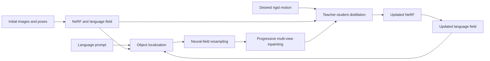

<div align="center">
<h1>NEO: NeRF It Once, Edit It Many Times</h1>
<h2> Accepted in IEEE Robotics and Automation Letters 2026 </h2>

[**Mikołaj Zieliński**](https://scholar.google.com/citations?user=ISOdWukAAAAJ&hl=en&oi=ao)<sup>1,2</sup>,
[**David Hall**](https://scholar.google.com.au/citations?user=dosODoQAAAAJ&hl=en)<sup>2</sup>,
[**Dominik Belter**](https://scholar.google.com.au/citations?user=3XvUbbMAAAAJ&hl=en&oi=ao)<sup>1</sup>,
[**Peyman Moghadam**](https://scholar.google.com.au/citations?user=QAVcuWUAAAAJ&hl=en&oi=ao)<sup>2</sup>

<sup>1</sup>Poznan University of Technology&emsp;&emsp;&emsp;<sup>2</sup>CSIRO Robotics
<br>

<a href="https://arxiv.org/abs/2607.24538v1"></a>
<a href='https://csiro-robotics.github.io/NEO/'></a>
<a href=''></a>


</div>

This is the official repository for NEO, a language-guided, persistent NeRF editing process for continuous object manipulation.

NEO predicts future scene states from a single initial scan. A text prompt
selects an object, NEO removes it from the neural field, reconstructs the
revealed background, and distills the object at its target pose into an updated
NeRF. The updated NeRF and language field can be reused for the next robot
action without scanning the scene again.

## Method



Given a set of initial images and poses, a NeRF and corresponging language field is first learnt as the starting implicit representation. 
From this representation, a 3D bounding box around an object/region for editing is defined either through a language prompt (as used in the paper) or manually through a GUI interface (see GUI section below).

After this, the editing pipeline has three stages:

1. **Object removal:** ray intervals inside the selected 3D bounding box are
   excluded and samples are reallocated to the visible parts of each ray.
2. **Background completion:** virtual object-centred views are inpainted in
   2x2 grids and used as masked supervision for NeRF refinement.
3. **Persistent reconfiguration:** original, object-removed, and transformed
   object fields supervise one student NeRF through field, RGB, and depth
   distillation.

NEO supports rigid object removal and relocation in static scenes. It does not
currently model articulated, deformable, or changing-background interactions.
Diffusion inpainting is stochastic, so repeated runs may produce different
content in regions that were never observed.

## Requirements

- Linux and Python 3.10
- NVIDIA GPU with CUDA support
- about 24 GB of GPU memory for the published NEO configuration
- FFmpeg and COLMAP for preparing new scenes
- Hugging Face access for the Stable Diffusion inpainting weights

The reference software versions are PyTorch 2.6 and CUDA 12.4. The modified
Nerfstudio, LERF, Robot-LERF, NeRFiller, and tiny-cuda-nn sources are physically
vendored in `submodules/`; their provenance is recorded in
[submodules/README.md](submodules/README.md).

## Installation

Create the runtime environment and compile tiny-cuda-nn for the locally
installed NVIDIA GPU architecture:

```bash
./scripts/create_environment.sh
conda activate neo
ns-install-cli
```

The script creates the `neo` Conda environment from `environment.yml` and then
builds the vendored tiny-cuda-nn source against its PyTorch, CUDA, and GPU
architecture. No machine-specific tiny-cuda-nn binary is stored in this
repository. The environment also installs the vendored Nerfstudio, LERF, and
Robot-LERF packages, COLMAP used by `ns-process-data`, and the CUDA 12.4 build
toolchain. It deliberately excludes raw ROS/RealSense capture tools,
development tools, and the NeRFiller baseline.

For an existing `neo` environment, rebuild tiny-cuda-nn with:

```bash
conda activate neo
./scripts/install_tinycudann.sh
```

Install optional components only when needed:

```bash
# ROS bags and RealSense capture processing
pip install -e ".[capture]"

# NeRFiller baseline
pip install -e ./submodules/neo_nerfiller

# All paper and capture dependencies
pip install -e ./submodules/neo_nerfiller
pip install -e ".[paper,capture]"
```

Download the Segment Anything ViT-H checkpoint:

```bash
mkdir -p ckpts
wget -O ckpts/sam_vit_h_4b8939.pth \
  https://dl.fbaipublicfiles.com/segment_anything/sam_vit_h_4b8939.pth
```

Check the installation:

```bash
python -c "import neo.neo_config; print('NEO import OK')"
python -c "import tinycudann; print('tiny-cuda-nn import OK')"
ns-train neo --help
ns-convert to-neo --help
neo-remove --help
neo-reconfigure --help
neo-assembly --help
```

### CUDA note

Do not manually symlink a host file such as `libcuda.so.565.77` into the Conda
environment. That filename belongs to one particular NVIDIA driver version and
would make the environment machine-specific. The host NVIDIA driver provides
`libcuda`; the PyTorch wheel provides its matching CUDA runtime libraries. If
`python -c "import torch; print(torch.cuda.is_available())"` prints `False`,
check the NVIDIA driver and the PyTorch/CUDA installation instead of adding a
library symlink.

## Data

NEO expects registered `before` and `after` Nerfstudio datasets:

```text
<neo_data_root>/processed/<action>/<scene>/<object>/
|-- before/
|   |-- images/
|   |-- depth/
|   `-- transforms.json
|-- after/
|   |-- images/
|   |-- depth/
|   `-- transforms.json
|-- bbox.json
`-- movement.json or movement.txt
```

Removal uses `action: remove`; rigid reconfiguration uses
`action: reconfigure`. Depth images are stored in millimetres. The
capture, registration, movement, and raw-file conventions are described in
[docs/DATASET.md](docs/DATASET.md).

## Quick Start

The public quick start will use a downloadable example scene and checkpoint.
Those artifacts do not yet have release URLs. Once a prepared scene is placed
under the layout above, copy a paper manifest, change its scene and prompt
fields, and run the appropriate installed command:

```bash
neo-remove --load-config my_removal.yaml
neo-reconfigure --load-config my_reconfiguration.yaml
```

Config paths passed to `--load-config` are relative to `experiments/`. Use the
individual boolean pipeline options shown by `--help` to reuse existing data,
checkpoints, or bounding boxes instead of rerunning every stage.

## Custom Scene Workflow

1. Capture images with known camera poses and convert them to the Nerfstudio
   data layout.
2. Train the initial `lerf-lite` language field.
3. Run `lerftogo-neo` through the runner to localize the prompted object and
   write `bbox.json`.
4. Convert the language-field checkpoint with `ns-convert to-neo` and run the
   NEO edit.
5. For relocation, provide the rigid object motion and run language-field
   loopback so the edited state can be queried again.

The vendored LERF package supplies `lerf-lite` and `lerf-lite-lan`; the vendored
Robot-LERF package supplies `lerftogo-neo`. Bounding-box translation and yaw
offsets can be adjusted in its viewer before editing.

## Paper Reproduction

Paper manifests are plain YAML files under `experiments/paper`. Set `timestamp`
to a reference run timestamp when reusing checkpoints, or leave it `null` for
the runner to select/create a run.

### Object removal

The five scenes and prompts are:

| Scene | Prompt |
| --- | --- |
| `mustard_bottle` | Mustard bottle |
| `orange` | Orange |
| `red_robot` | Red robot |
| `spam` | Spam can |
| `tomato_soup_can` | Tomato soup can |

Run one scene with:

```bash
neo-remove --load-config paper/removal/tomato_soup_can.yaml
```

The full-image metrics check preservation of the unedited scene. The `Out`
mask is the projection of the object's original 3D bounding box and measures
the newly revealed region.

### Object relocation

The six scenes and prompts are:

| Scene | Prompt |
| --- | --- |
| `banana` | Banana |
| `orange` | Orange |
| `rubiks_cube` | Rubik's cube |
| `spam` | Spam can |
| `sugar` | Sugar box |
| `tomato_soup_can` | Tomato soup can |

Run one scene with:

```bash
neo-reconfigure --load-config paper/relocation/banana.yaml
```

`Out` measures the original object region after removal; `In` measures the
object at its target pose. Both masks are generated by projecting the
corresponding 3D bounding boxes into the evaluation views.

### Four-step assembly

The tracked manifest performs all four edits in paper order:

| Step | Object | Prompt |
| ---: | --- | --- |
| 0 | `lego_bricks_1` | Lego bricks |
| 1 | `red_cup` | Red cup |
| 2 | `lego_bricks_2` | Lego bricks |
| 3 | `golf_ball` | Golf ball |

```bash
neo-assembly --load-config paper/assembly.yaml
```

Each completed step produces a new NeRF and language field that become the
input state for the next step. Only the initial scan and reference object
motions are inputs to the full sequence.

## Evaluation

The paper reports PSNR, SSIM, depth RMSE, and photometric reprojection error for
the full image and edited masks. Current evaluation defaults are documented in
[docs/REPRODUCIBILITY.md](docs/REPRODUCIBILITY.md).

Experiment runners invoke evaluation when their evaluation stage is enabled.
For an individual edited checkpoint, use:

```bash
ns-eval-neo --config-path \
  outputs/<action>/<scene>/<object>/before/neo/<timestamp>/replace-nerf/config.yml
```

Typical artifacts are written to:

```text
outputs/<action>/<scene>/<object>/before/
|-- lerf-lite/<timestamp>/
`-- neo/<timestamp>/
    |-- config.yml
    |-- bbox.json
    |-- sparse-guided-nerf/
    `-- replace-nerf/

renders/     rendered RGB, depth, and masks
eval/        per-scene metric JSON files
```

Aggregate available result files with:

```bash
python -m scripts.average_metrics_tables --help
```

The repository includes the modified NeRFiller source in
`submodules/neo_nerfiller`, but the basic environment does not install it. DFF
and Seal3D implementations are not bundled; their exact result provenance still
needs to be attached to the final release.

## Repository Layout

```text
neo/                 Nerfstudio models, pipelines, rendering, and metrics
submodules/          Physical copies of modified runtime dependencies
scripts/             Data, editing, evaluation, and experiment commands
experiments/paper/   Portable paper experiment manifests
docs/                Dataset and reproducibility documentation
tests/               CPU-safe release checks
notebooks/           Development and data-inspection notebooks
```

## Citation

See [CITATION.cff](CITATION.cff), or cite:

```bibtex
@article{zielinski2026neo,
  title   = {NEO: NeRF It Once, Edit It Many Times for Continuous Object Manipulation},
  author  = {Zielinski, Mikolaj and Hall, David and Belter, Dominik and Moghadam, Peyman},
  year    = {2026}
}
```

## License

A public software and dataset license has not yet been assigned. Until the
copyright holders add license files, this repository is source-available for
review and does not grant open-source reuse rights.
